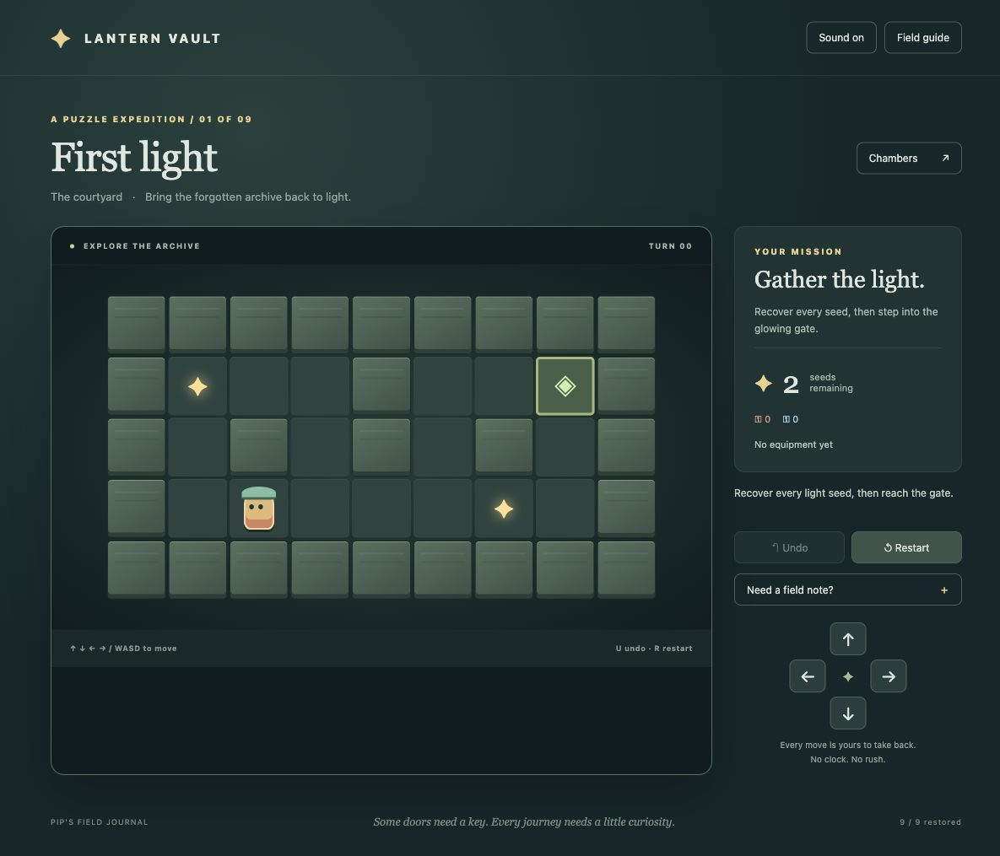
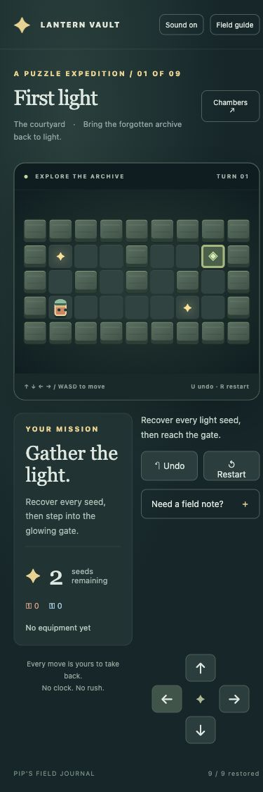

# Lantern Vault

An original nine-chamber tile puzzle expedition inspired by the logical navigation of Chip's Challenge. Courier Pip restores a forgotten mountain archive by collecting light seeds, unlocking colored doors, building crate bridges, finding protective equipment and mastering ice and arrow currents.

## Play locally

Requires Node 24. From this directory:

```sh
npm ci
npm run dev
```

Open http://127.0.0.1:5183. Port 5183 is strict; occupied ports fail rather than taking a neighbor's port. The server binds only to this Mac. The delivered server runs in an ordinary Terminal window; it continues while that Terminal process and Mac session remain alive. Closing it, signing out or rebooting stops it. Restart with `npm run dev`; no boot/login startup or system configuration is installed.

Arrow keys / WASD move. Click a neighboring tile or use the D-pad. U undoes an entire turn; R restarts. Field guide explains every tile. Chambers unlock in order; completion, best moves and mute save on this browser/device. In-progress boards do not survive reload. Chambers → Reset expedition progress clears local campaign progress. Reduced-motion system preferences are respected.

## Rules

Every accepted move is one deterministic turn, including forced movement. All seeds are required for a gate. Red/blue keys are consumed by matching doors. Crates push one at a time on floor, bridge water, and extinguish fire; they cannot push onto items, ice or currents. Ember boots protect fire, wave cloak protects water, cleats stop ice, anchor stops currents. A forced-motion loop causes recoverable loss. All state can be restored by undo or restart. No moving enemies or countdowns.

## Verify

```sh
npm test
npm run typecheck
npm run build
npm audit --audit-level=high
node --import tsx tests/solve.ts
```

Campaign solution certificates live in `src/solutions.json`; the test suite replays them through the public Session command API. The solver is development tooling, not bundled into the game. Tests also prove both stage-eight crates are required. CI repeats tests, production build/typecheck and audit on pushes.

See [acceptance criteria](docs/SPEC.md), [glossary](GLOSSARY.md), [verification evidence](docs/VERIFICATION.md), and [review results](docs/REVIEW.md).

All layouts, character design, CSS art and synthesized tones are original. No commercial assets or external runtime services. The folder is a Git clone; no Codex sidebar project registration was performed.



